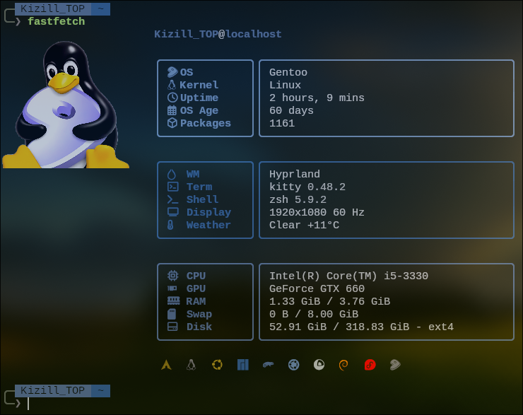

# Kizill's Fastfetch Config

A custom Fastfetch configuration featuring double-bordered boxes, Nerd Font icons, and ANSI colors. 



## Features
* **Double-border layout:** Clean separation between keys and values.
* **Nerd Font Icons:** Fully relies on Nerd Fonts for UI elements.
* **Truecolor / ANSI:** Easy to adapt with Pywal or any terminal color scheme.
* **Manual Padding:** Values are padded manually to ensure the right border `│` is perfectly aligned regardless of terminal size.

## Dependencies
* `fastfetch` (latest version recommended)
* A terminal that supports Kitty graphics protocol (e.g., `kitty`, `wezterm`)
* A Nerd Font (e.g., `JetBrainsMono Nerd Font`)

## Installation
1. Clone this repository:
   ```bash
   git clone https://github.com/YOUR_USERNAME/kizill-fastfetch.git
   ```
    Copy the config to your Fastfetch directory:
    ```bash
    cp kizill-fastfetch/config.jsonc ~/.config/fastfetch/config.jsonc
    ```

   Important: Edit the logo.source path in config.jsonc to point to your own image file.
    ```jsonc
    "source": "~/Загрузки/tux.png"
    ```
## 🌤️ Weather Module
The config uses a custom script (`weather.sh`) to display the current weather. 

1. **Make it executable:**
   ```bash
   chmod +x ~/.config/fastfetch/weather.sh
   ```

   Change your city:
   Open ~/.config/fastfetch/weather.sh and change the CITY variable to your location:

    CITY="YourCity"

Note: If you don't want the weather module, simply delete or comment out the weather line in config.jsonc.

⚠️ Manual Alignment (Read this!)

Because Fastfetch does not automatically pad strings to the right, you must manually adjust the spaces in the format sections of config.jsonc if your hardware names are longer or shorter than mine.

For example, if your GPU name is much longer, the right border will get pushed out. Find the gpu module and add/remove spaces before the │:
```jsonc
// Adjust the spaces here 
{ "type": "gpu", "key": "...", "format": "\u001b[97m {name}                       \u001b[35m│\u001b[0m" },
```
Use a monospace font to make counting spaces easier.
